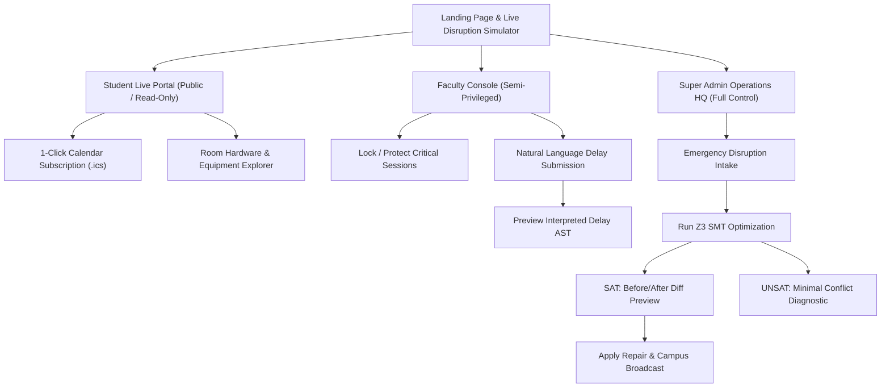

# Application Flow & UX Pathways (App Flow) — Campus Rescue

This document maps the user interaction flows, state transitions, and UI wireframe pathways for all three user roles: **Student**, **Faculty**, and **Super Admin**.

---

## 1. High-Level Navigation Architecture



---

## 2. Student Interaction Flow

```
[Screen S1: Public Day Schedule]
       │
       ├──> Filter by Department / Room / Time
       │
       ├──> Click "Subscribe to Calendar" ──> [Modal: Copy .ics URL or Download]
       │
       └──> Tap on Relocated Event ──> [Card: Room change notice & hardware tags]
```

### Screen S1 Details:
- **Header:** Today's Date, Active Status: `Campus Schedule Verified`.
- **Event List Item:**
  - `Robotics Workshop`
  - Badge: `Relocated ➔ Maker Lab D` (Golden highlight badge).
  - Time: `14:00 - 16:00`.
  - Equipment tags: `[electronics_kits]` `[projector]`.
  - Supervisor: `Prof. Rao`.
- **Sticky Footer Action:** `Subscribe to Live Calendar Feed (.ics)`.

---

## 3. Faculty Interaction Flow

```
[Screen F1: My Assigned Sessions]
       │
       ├──> Toggle "PROTECTED" lock on Exam / Viva
       │
       └──> Tap "Report Availability / Delay"
                 │
                 ▼
       [Screen F2: Natural Language Delay Intake]
       (Input: "I am delayed and can supervise only after 3:15 PM")
                 │
                 ▼
       [Screen F3: Interpretation Preview]
       (Shows: Gemma parsed slot 12 / 15:00 boundary)
                 │
                 ├──> Confirms ──> Pushed to Admin Disruption Queue
                 └──> Edits ────> Re-parse
```

### Screen F1 Details:
- Displays only sessions where `supervisor_id == current_user`.
- Next to each high-stakes event, a padlock icon: **`[Locked: Protected]`**. Protected events are guaranteed never to move during automatic repairs.

---

## 4. Super Admin Interaction Flow (Core Control Loop)

```
[Screen A1: Operations Command Center]
       │
       ├──> [Panel 1]: Current Day Schedule Grid (4 Rooms x 16 Slots)
       │
       └──> [Panel 2]: Emergency Disruption Desk
                 │
                 ├── Type Natural Language: "Lab A flooded after 2 PM"
                 │   OR Select Preset Button [Preset 1: Room Closure]
                 │
                 ▼
       [Screen A2: Interpretation & Confirmation Gate]
       (Gemma outputs allowlisted JSON: close_room lab_a [10..16])
                 │
                 ├── [Confirm & Run Solver]
                 └── [Reject / Edit Request]
                 │
                 ▼
       [Screen A3: Solver Evaluation Engine]
                 │
                 ├─── If Feasible (SAT) ──────────────────────────────┐
                 │                                                    │
                 ▼                                                    ▼
       [Screen A4: SAT Diff Inspection]              [Screen A5: UNSAT Conflict Arbiter]
       - Events Changed: 1                           - Status: Infeasible under hard rules
       - Total Minutes Displaced: 0                  - Conflicting Core: [Room Closure, Capacity]
       - Validator: 8/8 checks PASSED                - Propose Rule Relaxation:
       - Side-by-side comparison table                 (e.g., "Allow Maker Lab D capacity 40?")
                 │                                                    │
                 ├── [Apply Repair & Broadcast] ──> State Updated     └── [Modify Disruption]
                 └── [Discard Proposal] ─────────> State Reverted
```

---

## 5. Screen Layout & Wireframe Specifications

### Screen A4: The Repair Diff Inspection Interface
- **Top Metric Cards:**
  - `Total Events: 6`
  - `Events Moved: 1`
  - `Time Displacement: 0 hrs`
  - `Validation: 100% Passed`
- **Diff Table:**
  | Event Name | Original Room / Time | Repaired Room / Time | Status |
  | :--- | :--- | :--- | :--- |
  | **Robotics Workshop** | `Lab A (14:00 - 16:00)` | `Lab D (14:00 - 16:00)` | 🟡 **Moved (Equipment Match)** |
  | **Coding Assessment** | `Lab B (14:00 - 16:00)` | `Lab B (14:00 - 16:00)` | 🟢 **Protected (Untouched)** |
  | **Club Meeting** | `Seminar C (14:00 - 15:00)` | `Seminar C (14:00 - 15:00)` | ⚪ **Retained** |
- **Action Buttons:**
  - `[Apply Repair & Publish Updates]` (Green button)
  - `[Discard Proposal]` (Muted red button)
  - `[Export iCal (.ics)]` (Secondary link)
