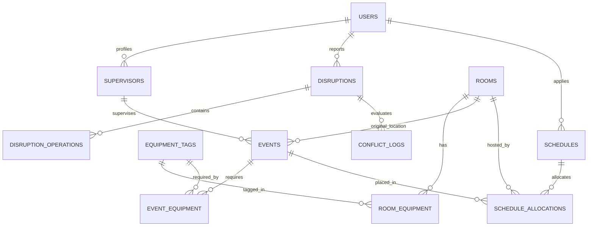

# Database Schema Specification (DB Schema) — Campus Rescue

**Database Engine:** PostgreSQL 15+ / SQLite 3 (Local prototype compatible)  
**ORM Support:** SQLAlchemy 2.0 / Pydantic V2  

---

## 1. Entity Relationship Diagram (ERD)



---

## 2. Table Specifications & DDL (Data Definition Language)

### 2.1 User & Identity Domain

```sql
-- User Accounts and Roles
CREATE TABLE users (
    id VARCHAR(64) PRIMARY KEY,
    name VARCHAR(255) NOT NULL,
    email VARCHAR(255) UNIQUE NOT NULL,
    role VARCHAR(32) NOT NULL CHECK (role IN ('student', 'faculty', 'super_admin')),
    department VARCHAR(128) NOT NULL,
    created_at TIMESTAMP WITH TIME ZONE DEFAULT CURRENT_TIMESTAMP
);

-- Supervisor Profile
CREATE TABLE supervisors (
    id VARCHAR(64) PRIMARY KEY,
    user_id VARCHAR(64) REFERENCES users(id) ON DELETE SET NULL,
    full_name VARCHAR(255) NOT NULL,
    title VARCHAR(64) DEFAULT 'Professor',
    department VARCHAR(128) NOT NULL
);
```

---

### 2.2 Campus Facilities Domain

```sql
-- Campus Physical Rooms
CREATE TABLE rooms (
    id VARCHAR(64) PRIMARY KEY,
    name VARCHAR(255) NOT NULL,
    building VARCHAR(128) NOT NULL,
    capacity INTEGER NOT NULL CHECK (capacity > 0),
    open_start_slot INTEGER NOT NULL DEFAULT 0,  -- 0 = 09:00
    open_end_slot INTEGER NOT NULL DEFAULT 16,   -- 16 = 17:00
    is_active BOOLEAN NOT NULL DEFAULT TRUE
);

-- Equipment Master
CREATE TABLE equipment_tags (
    id VARCHAR(64) PRIMARY KEY,
    name VARCHAR(128) NOT NULL,
    description TEXT
);

-- Room Equipment Association (Many-to-Many)
CREATE TABLE room_equipment (
    room_id VARCHAR(64) REFERENCES rooms(id) ON DELETE CASCADE,
    equipment_id VARCHAR(64) REFERENCES equipment_tags(id) ON DELETE CASCADE,
    PRIMARY KEY (room_id, equipment_id)
);
```

---

### 2.3 Events Domain

```sql
-- Scheduled Events for Daily Timetable
CREATE TABLE events (
    id VARCHAR(64) PRIMARY KEY,
    name VARCHAR(255) NOT NULL,
    event_date DATE NOT NULL,
    attendance INTEGER NOT NULL CHECK (attendance > 0),
    duration_slots INTEGER NOT NULL CHECK (duration_slots > 0),
    earliest_start_slot INTEGER NOT NULL DEFAULT 0,
    latest_end_slot INTEGER NOT NULL DEFAULT 16,
    original_room_id VARCHAR(64) REFERENCES rooms(id) NOT NULL,
    original_start_slot INTEGER NOT NULL,
    supervisor_id VARCHAR(64) REFERENCES supervisors(id) ON DELETE SET NULL,
    is_protected BOOLEAN NOT NULL DEFAULT FALSE,
    created_at TIMESTAMP WITH TIME ZONE DEFAULT CURRENT_TIMESTAMP
);

-- Event Required Equipment (Many-to-Many)
CREATE TABLE event_equipment (
    event_id VARCHAR(64) REFERENCES events(id) ON DELETE CASCADE,
    equipment_id VARCHAR(64) REFERENCES equipment_tags(id) ON DELETE CASCADE,
    PRIMARY KEY (event_id, equipment_id)
);
```

---

### 2.4 Disruption Ingestion & Operations Domain

```sql
-- Log of Natural-Language Disruptions
CREATE TABLE disruptions (
    id VARCHAR(64) PRIMARY KEY,
    reported_by_user_id VARCHAR(64) REFERENCES users(id),
    raw_prompt TEXT NOT NULL,
    parsed_status VARCHAR(32) NOT NULL CHECK (parsed_status IN ('ready', 'needs_clarification', 'unsupported')),
    clarification_question TEXT,
    created_at TIMESTAMP WITH TIME ZONE DEFAULT CURRENT_TIMESTAMP
);

-- Discrete Normalized Operations from Gemma AST
CREATE TABLE disruption_operations (
    id SERIAL PRIMARY KEY,
    disruption_id VARCHAR(64) REFERENCES disruptions(id) ON DELETE CASCADE,
    operation_type VARCHAR(32) NOT NULL CHECK (operation_type IN (
        'close_room', 'change_attendance', 'delay_supervisor', 'protect_event'
    )),
    target_room_id VARCHAR(64) REFERENCES rooms(id) ON DELETE CASCADE,
    target_event_id VARCHAR(64) REFERENCES events(id) ON DELETE CASCADE,
    target_supervisor_id VARCHAR(64) REFERENCES supervisors(id) ON DELETE CASCADE,
    start_slot INTEGER,
    end_slot INTEGER,
    numeric_value INTEGER
);
```

---

### 2.5 Solver Results & Allocation Snapshots

```sql
-- Versioned Schedule States
CREATE TABLE schedules (
    id VARCHAR(64) PRIMARY KEY,
    schedule_date DATE NOT NULL,
    version INTEGER NOT NULL DEFAULT 1,
    is_active BOOLEAN NOT NULL DEFAULT FALSE,
    applied_by_user_id VARCHAR(64) REFERENCES users(id),
    applied_at TIMESTAMP WITH TIME ZONE
);

-- Event Placement per Schedule Version
CREATE TABLE schedule_allocations (
    id SERIAL PRIMARY KEY,
    schedule_id VARCHAR(64) REFERENCES schedules(id) ON DELETE CASCADE,
    event_id VARCHAR(64) REFERENCES events(id) ON DELETE CASCADE,
    assigned_room_id VARCHAR(64) REFERENCES rooms(id) NOT NULL,
    assigned_start_slot INTEGER NOT NULL,
    is_changed BOOLEAN NOT NULL DEFAULT FALSE,
    displacement_slots INTEGER NOT NULL DEFAULT 0,
    CONSTRAINT unique_event_per_schedule UNIQUE (schedule_id, event_id)
);

-- Conflict & UNSAT Diagnostic History
CREATE TABLE conflict_logs (
    id SERIAL PRIMARY KEY,
    disruption_id VARCHAR(64) REFERENCES disruptions(id) ON DELETE CASCADE,
    is_sat BOOLEAN NOT NULL,
    unsat_core_tags TEXT[],          -- Array of conflicting constraint names
    human_explanation TEXT NOT NULL,
    created_at TIMESTAMP WITH TIME ZONE DEFAULT CURRENT_TIMESTAMP
);
```

---

## 3. Recommended Database Indexes

```sql
-- Fast query index for active timetable display
CREATE INDEX idx_events_date ON events(event_date);
CREATE INDEX idx_allocations_schedule ON schedule_allocations(schedule_id);
CREATE INDEX idx_allocations_room ON schedule_allocations(assigned_room_id, assigned_start_slot);

-- Fast lookup for disruptions
CREATE INDEX idx_disruptions_created ON disruptions(created_at DESC);
```
