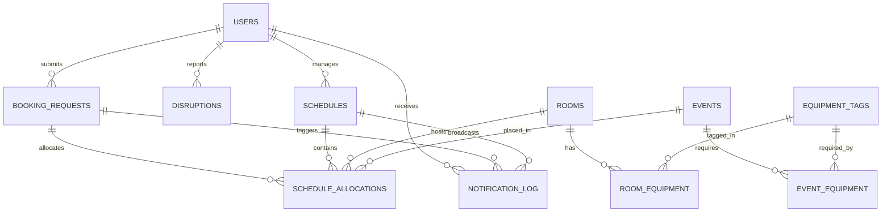

# Database Schema Specification (DB Schema) — Campus Rescue

**Database Engines:** PostgreSQL 15+ / SQLite 3 (Local prototype compatible)  
**Version:** 2.0 (Includes Booking Requests, Buffer Slots, Notifications, & 2-Hour SLA Tracking)

---

## 1. Entity Relationship Diagram (ERD)



---

## 2. Table Specifications & SQL DDL

### 2.1 User & Identity Domain

```sql
CREATE TABLE users (
    id VARCHAR(64) PRIMARY KEY,
    name VARCHAR(255) NOT NULL,
    email VARCHAR(255) UNIQUE NOT NULL,
    role VARCHAR(32) NOT NULL CHECK (role IN ('student', 'faculty', 'super_admin')),
    department VARCHAR(128) NOT NULL,
    created_at TIMESTAMP WITH TIME ZONE DEFAULT CURRENT_TIMESTAMP
);

CREATE TABLE supervisors (
    id VARCHAR(64) PRIMARY KEY,
    user_id VARCHAR(64) REFERENCES users(id) ON DELETE SET NULL,
    full_name VARCHAR(255) NOT NULL,
    department VARCHAR(128) NOT NULL
);
```

---

### 2.2 Facilities & Equipment Domain

```sql
CREATE TABLE rooms (
    id VARCHAR(64) PRIMARY KEY,
    name VARCHAR(255) NOT NULL,
    building VARCHAR(128) NOT NULL,
    capacity INTEGER NOT NULL CHECK (capacity > 0),
    open_start_slot INTEGER NOT NULL DEFAULT 0,   -- Slot 0 = 09:00
    open_end_slot INTEGER NOT NULL DEFAULT 18,    -- Slot 18 = 18:00
    is_active BOOLEAN NOT NULL DEFAULT TRUE
);

CREATE TABLE equipment_tags (
    id VARCHAR(64) PRIMARY KEY,
    name VARCHAR(128) NOT NULL,
    description TEXT
);

CREATE TABLE room_equipment (
    room_id VARCHAR(64) REFERENCES rooms(id) ON DELETE CASCADE,
    equipment_id VARCHAR(64) REFERENCES equipment_tags(id) ON DELETE CASCADE,
    PRIMARY KEY (room_id, equipment_id)
);
```

---

### 2.3 Booking Requests Domain (New in v2.0)

```sql
CREATE TABLE booking_requests (
    id VARCHAR(64) PRIMARY KEY,
    requested_by VARCHAR(64) REFERENCES users(id) NOT NULL,
    event_name VARCHAR(255) NOT NULL,
    event_type VARCHAR(64) NOT NULL CHECK (event_type IN (
        'class', 'lab', 'workshop', 'hackathon', 'cultural_event', 'exam'
    )),
    request_date DATE NOT NULL,
    attendance INTEGER NOT NULL CHECK (attendance > 0),
    duration_slots INTEGER NOT NULL CHECK (duration_slots > 0),
    preferred_start_slot INTEGER,                 -- Nullable if user wants best time
    allow_time_suggestion BOOLEAN NOT NULL DEFAULT TRUE,
    required_equipment TEXT[] NOT NULL DEFAULT '{}',
    priority VARCHAR(32) NOT NULL DEFAULT 'medium' CHECK (priority IN (
        'low', 'medium', 'high', 'protected_exam'
    )),
    accessibility_needed BOOLEAN NOT NULL DEFAULT FALSE,
    setup_buffer_slots INTEGER NOT NULL DEFAULT 0,
    cleanup_buffer_slots INTEGER NOT NULL DEFAULT 0,
    
    -- Workflow & Status
    status VARCHAR(32) NOT NULL DEFAULT 'pending' CHECK (status IN (
        'pending', 'proposed', 'approved', 'auto_approved', 'rejected', 'cancelled'
    )),
    proposed_room_id VARCHAR(64) REFERENCES rooms(id),
    proposed_start_slot INTEGER,
    approved_by VARCHAR(64) REFERENCES users(id),
    auto_approved_at TIMESTAMP WITH TIME ZONE,
    
    -- SLA Deadlines
    created_at TIMESTAMP WITH TIME ZONE DEFAULT CURRENT_TIMESTAMP,
    sla_expires_at TIMESTAMP WITH TIME ZONE NOT NULL
);
```

---

### 2.4 Events & Active Timetable Domain

```sql
CREATE TABLE events (
    id VARCHAR(64) PRIMARY KEY,
    booking_request_id VARCHAR(64) REFERENCES booking_requests(id) ON DELETE SET NULL,
    name VARCHAR(255) NOT NULL,
    event_date DATE NOT NULL,
    attendance INTEGER NOT NULL CHECK (attendance > 0),
    duration_slots INTEGER NOT NULL CHECK (duration_slots > 0),
    setup_buffer_slots INTEGER NOT NULL DEFAULT 0,
    cleanup_buffer_slots INTEGER NOT NULL DEFAULT 0,
    earliest_start_slot INTEGER NOT NULL DEFAULT 0,
    latest_end_slot INTEGER NOT NULL DEFAULT 18,
    original_room_id VARCHAR(64) REFERENCES rooms(id) NOT NULL,
    original_start_slot INTEGER NOT NULL,
    supervisor_id VARCHAR(64) REFERENCES supervisors(id) ON DELETE SET NULL,
    is_protected BOOLEAN NOT NULL DEFAULT FALSE,
    calendar_uid VARCHAR(128) UNIQUE NOT NULL,    -- Unique iCal UID
    sequence_number INTEGER NOT NULL DEFAULT 0,   -- iCal revision sequence
    created_at TIMESTAMP WITH TIME ZONE DEFAULT CURRENT_TIMESTAMP
);
```

---

### 2.5 Schedules, Allocations & Notification Audit

```sql
CREATE TABLE schedules (
    id VARCHAR(64) PRIMARY KEY,
    schedule_date DATE NOT NULL,
    version INTEGER NOT NULL DEFAULT 1,
    is_active BOOLEAN NOT NULL DEFAULT FALSE,
    applied_by_user_id VARCHAR(64) REFERENCES users(id),
    applied_at TIMESTAMP WITH TIME ZONE,
    CONSTRAINT one_active_schedule_per_date UNIQUE (schedule_date, is_active)
);

CREATE TABLE schedule_allocations (
    id SERIAL PRIMARY KEY,
    schedule_id VARCHAR(64) REFERENCES schedules(id) ON DELETE CASCADE,
    event_id VARCHAR(64) REFERENCES events(id) ON DELETE CASCADE,
    assigned_room_id VARCHAR(64) REFERENCES rooms(id) NOT NULL,
    assigned_start_slot INTEGER NOT NULL,
    is_changed BOOLEAN NOT NULL DEFAULT FALSE,
    displacement_slots INTEGER NOT NULL DEFAULT 0,
    CONSTRAINT unique_event_per_schedule UNIQUE (schedule_id, event_id)
);

CREATE TABLE notification_log (
    id SERIAL PRIMARY KEY,
    recipient_user_id VARCHAR(64) REFERENCES users(id),
    recipient_role VARCHAR(32) NOT NULL,
    schedule_version INTEGER NOT NULL,
    notification_type VARCHAR(64) NOT NULL CHECK (notification_type IN (
        'booking_proposed', 'booking_approved', 'booking_auto_approved', 
        'booking_rejected', 'emergency_relocation'
    )),
    title VARCHAR(255) NOT NULL,
    message TEXT NOT NULL,
    dispatched_at TIMESTAMP WITH TIME ZONE DEFAULT CURRENT_TIMESTAMP
);

CREATE TABLE conflict_logs (
    id SERIAL PRIMARY KEY,
    disruption_context TEXT NOT NULL,
    is_sat BOOLEAN NOT NULL,
    unsat_core_tags TEXT[],                       -- Array of conflicting constraint tags
    conflict_explanation TEXT NOT NULL,
    created_at TIMESTAMP WITH TIME ZONE DEFAULT CURRENT_TIMESTAMP
);
```

---

## 3. Fast Indexes

```sql
CREATE INDEX idx_booking_status ON booking_requests(status);
CREATE INDEX idx_booking_sla ON booking_requests(sla_expires_at) WHERE status = 'proposed';
CREATE INDEX idx_events_date_room ON events(event_date, original_room_id);
CREATE INDEX idx_allocations_sched ON schedule_allocations(schedule_id);
CREATE INDEX idx_notifications_user ON notification_log(recipient_user_id, dispatched_at DESC);
```
