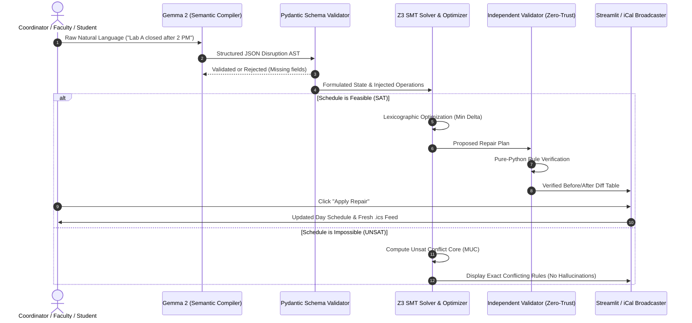

# Campus Rescue — System Architecture & Technical Specification

**System Type:** Neuro-Symbolic Disruption Repair Engine  
**Models:** Google Gemma 2 (2B / 9B) Open-Weights LLM  
**Deterministic Engine:** Z3 SMT Theorem Prover / Optimizer (`z3-solver` Python runtime)  
**Schema Layer:** Pydantic V2  
**Presentation Layer:** Streamlit Responsive Dashboard  

---

## 1. Architectural Overview & Control Loop

Standard chatbots predict text probabilistically. When applied to campus scheduling, they hallucinate phantom rooms, ignore equipment prerequisites, and create overlapping time slots. 

**Campus Rescue** decouples semantic translation from mathematical logic:



---

## 2. Component Breakdown

### 2.1 Gemma Semantic Compiler (`model_adapter.py`)
- **Role:** Translates messy, ambiguous English into an allowlisted, typed operation payload.
- **Supported Operations:**
  1. `close_room(room_id, start_slot, end_slot)`
  2. `change_attendance(event_id, new_attendance)`
  3. `delay_supervisor(supervisor_id, available_after_slot)`
  4. `protect_event(event_id)`
- **Safety Guarantee:** Gemma is prohibited from executing code or emitting scheduling recommendations directly. It serves exclusively as a parser. If input is unsupported or vague (e.g., *"Make everything better"*), Gemma outputs `{"status": "needs_clarification", "clarification_question": "..."}`.

### 2.2 Schema Contract & Data Models (`schemas.py`)
The system standardizes time into **30-minute integer slots** (Slot 0 = 09:00, Slot 16 = 17:00). All time intervals are half-open: `[start, end)`.

#### Core Schemas (Pydantic V2):
```python
from pydantic import BaseModel, Field
from typing import Set, Optional, List, Literal

class Room(BaseModel):
    id: str
    name: str
    capacity: int = Field(gt=0)
    equipment: Set[str]
    open_start: int = 0
    open_end: int = 16

class Event(BaseModel):
    id: str
    name: str
    attendance: int = Field(gt=0)
    duration_slots: int = Field(gt=0)
    required_equipment: Set[str]
    supervisor_id: Optional[str] = None
    earliest_start: int = 0
    latest_end: int = 16
    original_room_id: str
    original_start_slot: int
    protected: bool = False
```

---

### 2.3 The Deterministic SMT Engine (`solver.py`)

The scheduling engine uses **Z3 SMT Solver & Optimizer**. It formulates the problem as discrete integer satisfaction with multi-objective optimization.

#### Hard Constraints (Non-Negotiable Proofs):
1. **Domain & Boundaries:**
   $$\forall i, \quad \text{room}_i \in \text{AvailableRooms}, \quad \text{start}_i \ge \text{earliest}_i, \quad \text{start}_i + \text{duration}_i \le \text{latest}_i$$
2. **Room Capacity:**
   $$\forall i, \quad \text{Capacity}(\text{room}_i) \ge \text{attendance}_i$$
3. **Equipment Requirements:**
   $$\forall i, \quad \text{required\_equipment}_i \subseteq \text{Equipment}(\text{room}_i)$$
4. **Room Mutual Exclusion (No Overlaps):**
   $$\forall i \ne j, \quad (\text{room}_i \ne \text{room}_j) \lor (\text{start}_i + \text{dur}_i \le \text{start}_j) \lor (\text{start}_j + \text{dur}_j \le \text{start}_i)$$
5. **Supervisor Mutual Exclusion:**
   $$\forall i \ne j \text{ with same supervisor}, \quad (\text{start}_i + \text{dur}_i \le \text{start}_j) \lor (\text{start}_j + \text{dur}_j \le \text{start}_i)$$
6. **Room Closure:**
   $$\forall i \text{ where } \text{room}_i = \text{closed\_room}, \quad (\text{start}_i + \text{dur}_i \le \text{closure\_start}) \lor (\text{start}_i \ge \text{closure\_end})$$
7. **Protected Events:**
   $$\forall i \text{ where } \text{protected}_i = \text{true}, \quad \text{room}_i = \text{orig\_room}_i \land \text{start}_i = \text{orig\_start}_i$$

#### Lexicographic Objective (Minimal Disruption):
Rather than reshuffling the entire campus day, Z3 optimizes sequentially:
1. **Objective 1 (Top Priority):** Minimize count of altered events:
   $$\min \sum_i \mathbb{I}\left[(\text{room}_i \ne \text{orig\_room}_i) \lor (\text{start}_i \ne \text{orig\_start}_i)\right]$$
2. **Objective 2 (Second Priority):** Minimize total time displacement:
   $$\min \sum_i |\text{start}_i - \text{orig\_start}_i|$$
3. **Objective 3:** Minimize room change count.

#### Infeasibility & Conflict Core Extraction:
When the schedule is unsatisfiable, Z3 executes `assert_and_track()`. It returns the **Minimal Conflicting Core (MUC)**, mapping directly to human-readable rule descriptions (e.g., *`Conflict: [Robotics Attendance >= 40] clashes with [Lab A Closed] and [Lab D Capacity = 35]`*).

---

### 2.4 Independent Validator (`validator.py`)
A pure-Python validation module that operates with **zero trust** toward the solver and LLM:
- Inspects every candidate output from Z3.
- Re-verifies every constraint mathematically.
- If any discrepancy or double-booking is found, the proposal is rejected as an internal engine fault and never shown to the user.

---

### 2.5 User Presentation & Dispatch (`app.py`)
- Built with **Streamlit** for real-time reactivity without complex frontend build tools.
- Provides 3 clear functional panels:
  - **Left Panel:** Disruption input, demo presets, model status indicator.
  - **Middle Panel:** Current active day schedule with equipment badges and protection locks.
  - **Right Panel:** Side-by-side diff table, delta metrics, Z3 explanation, and **Apply Repair** / **Discard** buttons.
- Includes a 1-click **Download iCal (.ics)** button to allow students and faculty to import updated event times into their phones.
