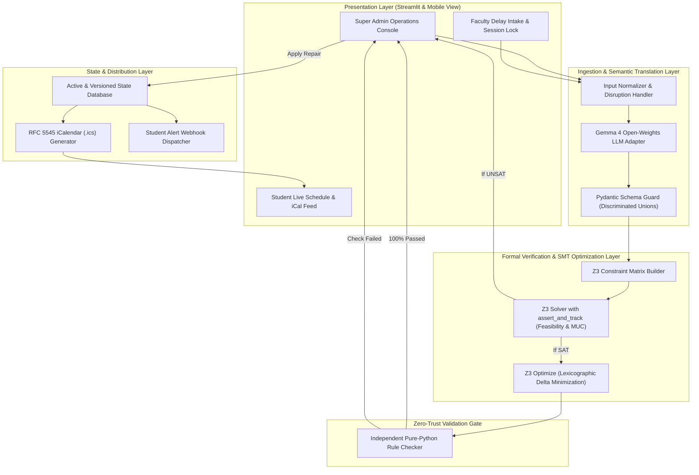
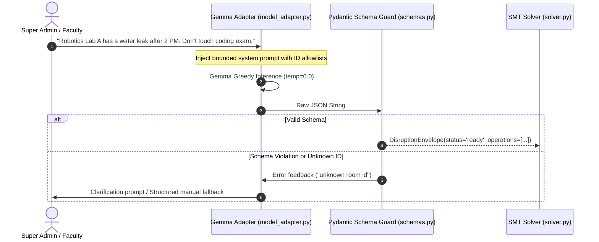
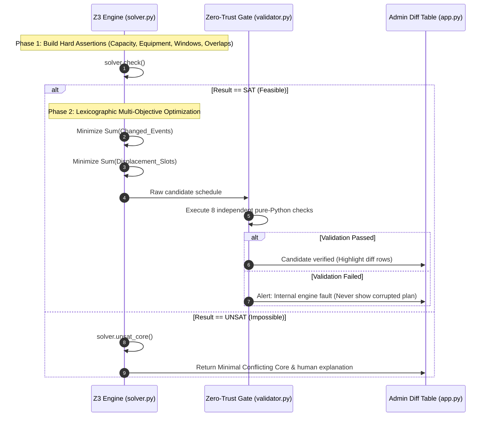

# System Architecture & End-to-End System Flow — Campus Rescue

**Architecture Paradigm:** Neuro-Symbolic State Machine  
**Key Invariants:** Zero Hallucination, Lexicographic Minimal Disruption, Decoupled Zero-Trust Verification  

---

## 1. Layered System Architecture



---

## 2. End-to-End System Flows

### Flow 1: Natural Language Disruption to SMT Translation



---

### Flow 2: SMT Constraint Execution & Lexicographic Optimization



---

## 3. Finite State Machine (FSM) Lifecycle

The application schedule state transitions through strictly defined lifecycle stages:

```
┌────────────────────┐
│  BASELINE_LOADED   │  (Seeded verified day schedule active)
└─────────┬──────────┘
          │ User submits disruption
          ▼
┌────────────────────┐
│     PARSING        │  (Gemma extracting structured AST)
└─────────┬──────────┘
          │ Schema verified
          ▼
┌────────────────────┐
│     SOLVING        │  (Z3 feasibility check & optimization)
└─────────┬──────────┘
          ├──────────────────────────────────┐
          │ If SAT                           │ If UNSAT
          ▼                                  ▼
┌────────────────────┐             ┌─────────────────────┐
│  CANDIDATE_READY   │             │ INFEASIBLE_CONFLICT │
└─────────┬──────────┘             └──────────┬──────────┘
          │ Independent check passes          │ User relaxes rule
          ▼                                   └─────────┐
┌────────────────────┐                                  │
│  PENDING_APPROVAL  │                                  │
└─────────┬──────────┘                                  │
          ├─────────────────────┐                       │
          │ Click "Apply"       │ Click "Discard"       │
          ▼                     ▼                       ▼
┌────────────────────┐   ┌──────────────┐   ┌────────────────────┐
│   STATE_APPLIED    │   │ RESET_TO_SEED│<──┤  RE-SOLVE_ATTEMPT  │
└────────────────────┘   └──────────────┘   └────────────────────┘
```

---

## 4. Fault Tolerance & Fallback Protocols

1. **LLM Downtime / High Latency:**
   - If local Gemma inference takes $> 3$ seconds or fails to respond, the UI automatically activates the **Structured Preset Panel** without crashing.
2. **Deterministic Fallback Labeling:**
   - The UI displays an explicit badge: `Live Gemma Inference` or `Structured Mode Active`. The system never misrepresents preset fallback parsing as live model execution.
3. **Optimality Timeout:**
   - If Z3 optimization takes $> 2$ seconds, the solver halts and returns the best-known feasible candidate, labeling it *Satisfiable (Greedy)* rather than claiming mathematical optimality.
4. **State Isolation:**
   - Proposed repairs are computed strictly on isolated copies of memory. The baseline active timetable remains immutable until the coordinator explicitly presses **Apply Repair**.
